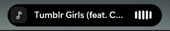
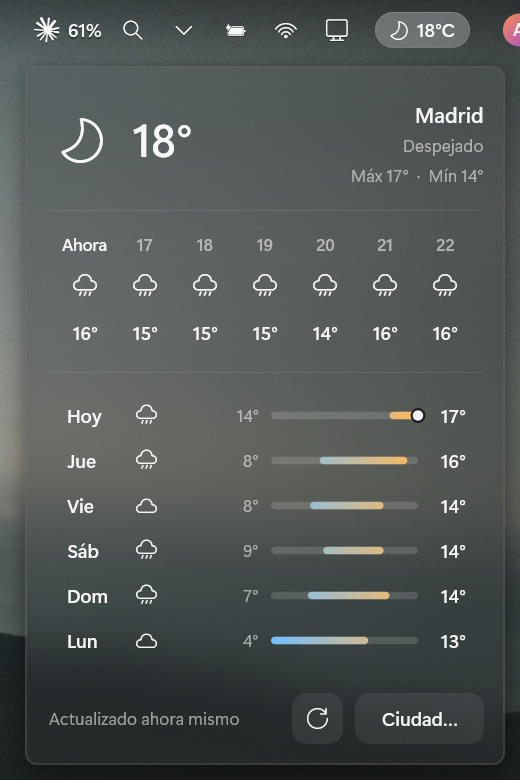
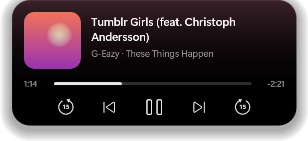
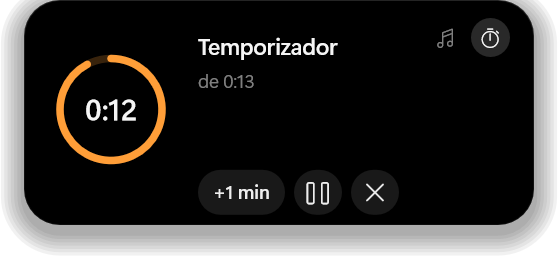
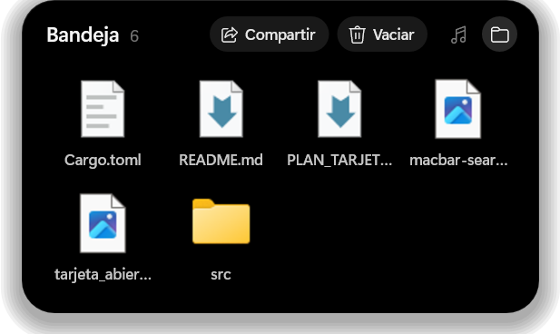
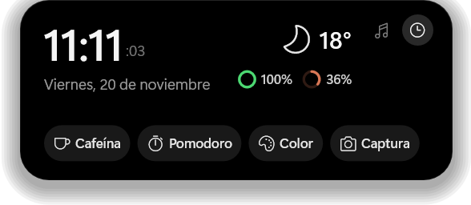
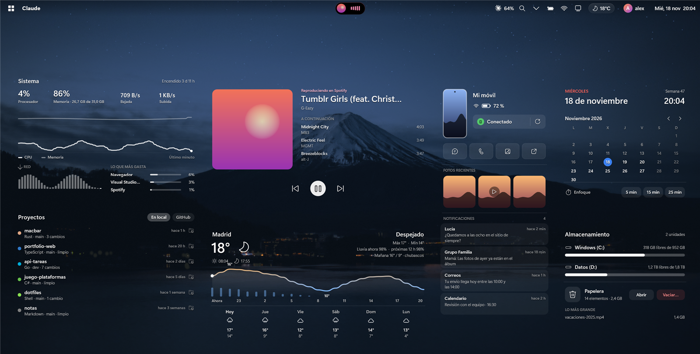
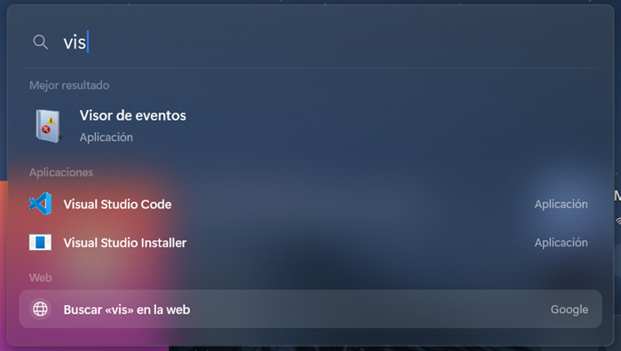
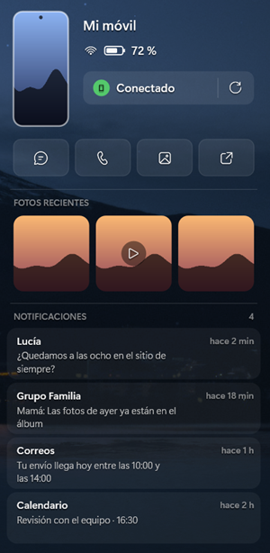

# macbar — macOS-style menu bar for Windows 11

**macbar** is a lightweight, native **macOS-style top menu bar for Windows 11**, written in **Rust** with **Win32 + Direct2D** (no Electron, no WebView). It adds a translucent top bar with app menus, a Dynamic Island–style media pill, a Control Center, Wi‑Fi and weather panels, a calendar, a system tray and its own Spotlight-like search, plus large animated **desktop widgets** rendered on the GPU — all using almost no CPU when idle.


<p align="center">
  
</p>

## Screenshots

| Control Center | Wi‑Fi | Weather | Calendar & timer |
|:---:|:---:|:---:|:---:|
|  |  |  |  |

<p align="center">
  
</p>

> 🇪🇸 Barra superior estilo macOS para Windows 11, nativa y ligera, hecha en Rust. La interfaz está en español.

## Features

- **macOS-like top bar** that reserves its own space on screen (AppBar), so maximized windows never cover it — it even recovers after sleep, lock/unlock, display or DPI changes and Explorer restarts.
- **Global app menu** (File, Edit, View, Go, Window, Help) acting on the active window, with macOS-style menu hopping.
- **Dynamic Island for Windows**: a central pill that shows now-playing music (album-art colors, live equalizer, progress), timers, volume/brightness HUDs and low-memory alerts.
- **Island card**: click the island and it grows into a large card (like the expanded Dynamic Island), then shrinks back into it — see below.
- **Media controls** for Spotify, YouTube Music and any app using Windows media sessions.
- **Control Center**: Wi‑Fi, Bluetooth, volume, brightness and quick toggles.
- **Wi‑Fi panel**: nearby networks with signal strength and one-click connect to saved networks.
- **Weather panel** powered by [Open‑Meteo](https://open-meteo.com) (no API key): current conditions, hourly and 6‑day forecast, animated icons.
- **Calendar & clock** with month navigation and a quick timer.
- **Search** (the magnifier): Start-menu apps (Store apps too), files and folders from the Windows Search index, Settings pages, a calculator and web search. Keyboard driven: type, ↑/↓, Enter; Ctrl+Enter opens a file's folder.
- **System tray** icons, battery and user avatar. macbar's own icon in the hidden-icons panel opens Settings.
- **Bluetooth** icon next to Wi‑Fi with a devices panel and an island notice when a device connects.
- **Cascading entrance animations** in the panels.
- **Auto-hides with fullscreen apps** (games, video, F11) and comes back afterwards.
- **Native & tiny**: a single small `.exe`, Direct2D/DirectWrite rendering, per-monitor DPI aware, near-zero idle CPU.

### Island card

<p align="center">
  
  &nbsp;
  
</p>
<p align="center">
  
  &nbsp;
  
</p>

Click the island and it widens, drops down and turns into a card; the album art (or the timer ring) travels from the pill to its place in one piece. It closes when the mouse leaves it, with a click outside or with Esc, and shrinks back into the island.

- **Music**: big album art, title on two lines, a progress bar you can drag, ±15 s jumps (only when the player allows seeking), and the album-art color as background.
- **Timer & Pomodoro**: big ring with rolling digits, +1 min, pause/resume, stop, skip phase, today's focus blocks and *Repeat* when it ends.
- **Shelf**: drag files onto the island and the card opens with a drop zone; files can be opened, shared, removed or dragged out to another app.
- **Glance** (optional): clock, date, weather, battery, weekly Claude usage and shortcuts (caffeine, Pomodoro, color picker, screenshot).
- Tabs appear when there is more than one thing to show. Notices (volume, brightness…) slide in at the top of the card while it is open.
- Keyboard: Space plays/pauses, ←/→ jump 5 s, ↑/↓ change the volume, Esc closes. Middle-click on the island plays/pauses.
- Respects Windows' *Animation effects* setting (fades instead of springs). Options in the bar's right-click menu: open with a click, open on hover, glance on an empty island.

### Desktop widgets



<p align="center">
  
  &nbsp;
  
</p>

Large, animated widgets that sit on the desktop (under your windows), rendered with Direct2D + DirectComposition on the GPU. Drag them anywhere — their positions are saved — resize them to one of 7 sizes, pick an alternative design and floating (no background) or glass-card style. Turn each one on or off in Settings.

- **Calendar** with timers and day details.
- **Weather** with an animated hourly curve, sunrise/sunset and 6-day forecast.
- **Music**: album art, seekable timeline, controls and your real **YouTube Music queue**.
- **System**: live CPU, RAM and network graphs plus top apps.
- **Storage & recycle bin**: drives, what's taking space in the bin, empty it or run Storage Sense.
- **Projects**: local Git repos and your GitHub repos, opened in Explorer, VS Code or a terminal.
- **Phone (Phone Link)**: a Phone Link–style header (phone frame with your wallpaper, name, battery, connection), shortcuts to messages, calls and photos, your phone's 3 latest photos and the phone notifications Phone Link mirrors to Windows.

## User guide

> The interface is in Spanish (English if Windows is in English). Labels below are given in English with the Spanish name in *italics* where it helps.

### The bar

| Where | Click | Right-click / other |
|---|---|---|
| Logo (left) | Control Center | — |
| App menus | Menus of the active window (File, Edit, View…) | Hover across menus to hop between them |
| Island (centre) | Opens the **island card** | Middle-click: play/pause · Horizontal swipe (touchpad / tilt wheel): next/previous track |
| Search (magnifier) | Search panel | — |
| Tray arrow | Hidden tray icons (blue dot = an icon wants attention) | macbar's own icon there opens **Settings** |
| Wi‑Fi | Networks, one-click connect | — |
| Bluetooth | Radio switch, paired devices (type, status, battery), *Add device…* | — |
| Weather | Hourly and 6-day forecast | — |
| Clock | Calendar and quick timer | — |
| Empty part of the bar | — | Short menu: *Configuración…*, widgets, desktop face, presentation mode, caffeine, Pomodoro, color picker, quick note, quit |

When a window is maximized the bar turns solid and joins it (can be turned off in Settings). With fullscreen apps it hides itself.

### The island

The pill in the middle shows what is going on: music, timers, calls (with mute), downloads, charging time, volume/brightness, Wi‑Fi and Bluetooth connections, camera/mic in use, low battery, disk almost full, high CPU…

Click it to open the **card**:

- **Music**: big artwork, draggable progress, ±15 s, controls.
- **Timer & Pomodoro**: ring, +1 min, pause, skip phase, *Repeat*.
- **Call**: mute and go back to the call app.
- **Audio**: choose the output device, volume and mute.
- **Shelf**: drop files on the island (or **shake the mouse while dragging a file** to get a drop basket next to the cursor). Open, share, drag out, **ZIP**, **convert to PNG/JPG**, **copy text from an image (OCR)**.
- **Glance** (optional): clock, weather, battery and shortcuts.

Card keys: `Space` play/pause · `←`/`→` ±5 s · `↑`/`↓` volume · `Esc` close.

### Search

Open it with the magnifier and type. `↑`/`↓` to move, `Enter` to run, `Ctrl+Enter` opens a file's folder. With the box empty you see recent items and the last copied texts.

| Type | What it does |
|---|---|
| an app, file, folder or setting name | Opens it (Start menu apps, Windows Search index, Settings pages) |
| `2*(3+4)` | Calculator (`Enter` copies the result) |
| `10 km to mi`, `5 kg en lb`, `30 c to f` | Unit conversion |
| `5 min`, `timer 90s`, `1h 30m` | Starts a timer in the island |
| `yt cats`, `gh macbar`, `w Madrid`, `maps cafe`, `tr hello`, `r rust`, `img dogs`, `so borrow`, `crates serde`, `npm react` | Searches that site |
| `:fire` | Emoji picker |
| `#ff8800`, `rgb(255,136,0)` | Colour preview |
| `left`, `right`, `top`, `bottom`, `max`, `almost`, `center`, `min` (or *izquierda*, *maximizar*…) | Snaps the window you were using |
| `uuid` · `password 24` · `b64 text` · `ts 1700000000` · `ip` · `lorem` | Dev tools (`Enter` copies) |
| `lock`, `sleep`, `dark`, `mute`, `shot`, `desktop`, `trash`, `taskmgr`, `restart`, `shutdown` | System commands |
| `caffeine`, `pomodoro`, `picker`, `note`, `face`, `present`, `settings` | macbar tools |
| anything else | Web search |

The clipboard history lives only in memory and skips passwords and anything password managers mark as private.

### Desktop and widgets

- **Two desktop faces**: one for widgets, one for your icons. **Double-click an empty spot of the desktop** or press **`Win+Alt+W`** to switch.
- **Turn widgets on/off** in *Configuración → Escritorio y widgets*. New widgets start hidden.
- **Move**: drag the widget. Positions are saved; widgets never overlap.
- **Size**: drag the handle in the bottom-right corner (it snaps to the nearest size), or right-click → *Tamaño*, or choose it in Settings. Sizes: Small, Medium, Strip, Tall, Large, Column, Extra large. The content changes with the size.
- **Design**: right-click → *Diseño*, or in Settings. Each widget has alternative designs (e.g. Weather *Sky*/*Minimal*, Music *Artwork*/*Vinyl*/*Cassette*, Clocks *Eye*, Storage *Tubes*); each design offers only the sizes where it makes sense.
- **Style**: floating (no background) or glass card.

Widgets: Calendar, Weather, Music, System, Storage, Projects, Phone (Phone Link), Visualizer, Photos, World clocks, To-do, Countdown, **News** and **Stocks**.

- **News**: in *Configuración → Noticias* pick Google News topics, country and language, add your own RSS/Atom feeds (checked when you add them), mute words and hide outlets.
- **Stocks**: in *Configuración → Bolsa* search a company by name (`santander` → `SAN.MC`), reorder by dragging, and choose the chart period, % or amount and refresh rate. Data from Yahoo Finance.
- **To-do / Countdown / Clocks**: edit them directly in the widget.

### Tools

| Tool | How |
|---|---|
| **Caffeine** (keep the PC awake) | Bar menu, search `caffeine` or `caffeine 2h` |
| **Pomodoro** | Bar menu or search `pomodoro`; controls in the island card |
| **Color picker** | Bar menu or search `picker`; click a pixel to copy its HEX |
| **Quick note** | Bar menu or search `note`. Hidden from screenshots and screen sharing |
| **Presentation mode** | Bar menu or search `present`. Hides widgets and notices |
| **Profiles and themes** | *Configuración → Perfiles y temas*: Work / Leisure / Personal, accent colour, export/import `.macbartema` |

### Settings

Open them from macbar's icon among the hidden tray icons, from the bar's right-click menu (*Configuración…*) or by searching `settings`. Everything is there: bar (position top/bottom, solid bar, Bluetooth icon), island and card (open on click/hover, glance, which notices to show), desktop and widgets (on/off, size, design, style), News, Stocks, weather location, profiles and themes, and *Iniciar con Windows*.

### Keyboard shortcuts

| Keys | Action |
|---|---|
| `Win+Alt+W` | Switch desktop face (widgets ↔ icons) |
| `Space` / `←` `→` / `↑` `↓` / `Esc` | In the island card: play-pause / ±5 s / volume / close |
| `↑` `↓` `Enter` / `Ctrl+Enter` | In search: move / open / open containing folder |

## Download

Grab `macbar.exe` from the [latest release](https://github.com/PelayoNaredo/macbar/releases/latest) and run it. No installer, no dependencies.

To start it with Windows, open Settings (macbar's icon in the hidden-icons panel, or right-click the bar → *Configuración…*) and turn on **Iniciar con Windows**.

Requirements: Windows 11 (Windows 10 may work but is untested), x64.

## Configuration

Optional file `%APPDATA%\macbar\config.ini`:

```ini
; weather location (otherwise it is detected automatically)
ciudad = Madrid
; or exact coordinates
; lat = 40.42
; lon = -3.70
; image shown inside the phone widget (set it by clicking the phone drawing)
; fondo_movil = C:\Users\you\Pictures\wallpaper.jpg
; island card: "pausar" makes a click on the island play/pause instead of opening the card
; tarjeta_clic = pausar
; open the card after hovering the island for a moment
; tarjeta_hover = si
; click the empty island spot to open the glance card
; tarjeta_vistazo = si
```

Widget positions and which widgets are on live in `%APPDATA%\macbar\widgets.ini`.

**Phone widget notes.** It needs Phone Link linked to your phone. Phone Link's own databases are encrypted, so the widget only uses what Windows exposes: the notifications Phone Link mirrors as Windows toasts, the phone's files under `%USERPROFILE%\CrossDevice` (for the latest photos), and the battery shown in the Phone Link window (read while that window is open, then remembered). The wallpaper isn't readable anywhere, so you pick the image yourself.

## Build from source

```bash
git clone https://github.com/PelayoNaredo/macbar.git
cd macbar
cargo build --release
```

Run it with `MACBAR_DEMO=1` to replace personal data (name, account picture, Wi‑Fi networks, city, PC name) with placeholders — handy for screenshots.

The binary ends up in `target/release/macbar.exe`. Needs a recent stable Rust toolchain (edition 2024) for `x86_64-pc-windows-msvc` or `-gnu`.

## FAQ

**How do I get a Mac menu bar on Windows 11?** Run macbar: it docks to the top of your primary monitor and reserves its space like the taskbar does.

**Does it replace the Windows taskbar?** No, it sits at the top and works alongside it. You can auto-hide the taskbar for a cleaner, more Mac-like desktop.

**Is it heavy?** No. It is plain Win32 + Direct2D and only redraws while something is animating. Widgets pause when your windows cover the desktop.

**Does the search replace Windows Search?** It opens from macbar's magnifier; Win+S still opens Windows' own search.

## Disclaimer

macbar is an independent open-source project. It is not affiliated with or endorsed by Apple, Microsoft or Anthropic. macOS is a trademark of Apple Inc.; Windows is a trademark of Microsoft Corporation.

## License

[MIT](LICENSE) © Pelayo Naredo
