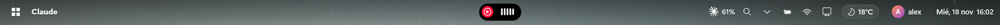
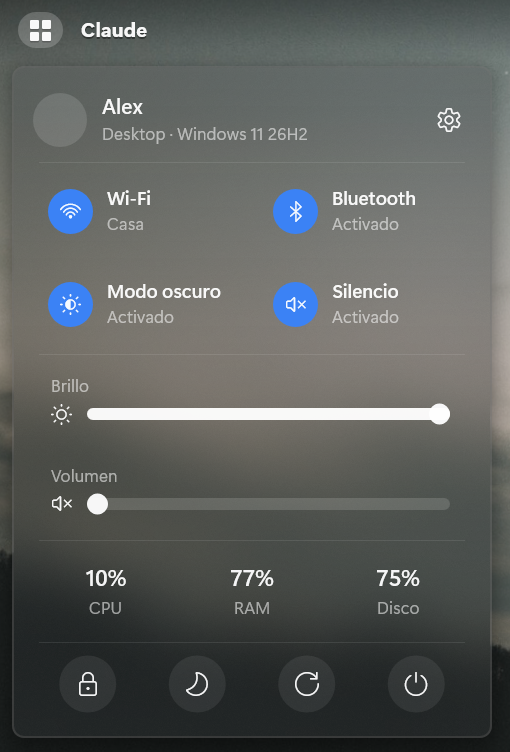
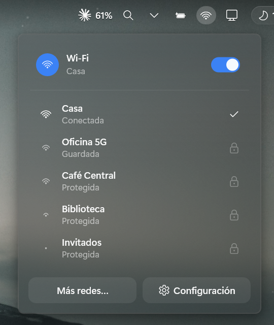
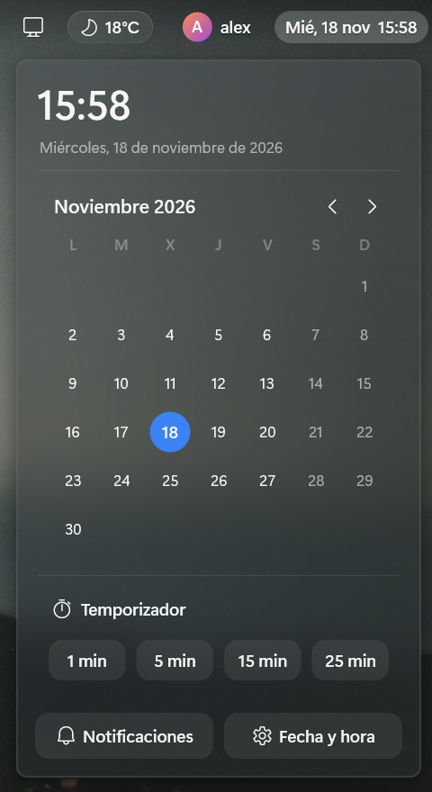
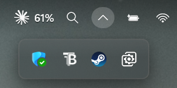

# macbar — macOS-style menu bar for Windows 11

**macbar** is a lightweight, native **macOS-style top menu bar for Windows 11**, written in **Rust** with **Win32 + Direct2D** (no Electron, no WebView). It adds a translucent top bar with app menus, a Dynamic Island–style media pill, a Control Center, Wi‑Fi and weather panels, a calendar, a system tray and its own Spotlight-like search, plus large animated **desktop widgets** rendered on the GPU — all using almost no CPU when idle.



<p align="center">
  
</p>

## Screenshots

| Control Center | Wi‑Fi | Weather | Calendar & timer |
|:---:|:---:|:---:|:---:|
|  |  |  |  |

<p align="center">
  
</p>

> 🇪🇸 Barra superior estilo macOS para Windows 11, nativa y ligera, hecha en Rust. La interfaz está en español.

## Features

- **macOS-like top bar** that reserves its own space on screen (AppBar), so maximized windows never cover it — it even recovers after sleep, lock/unlock, display or DPI changes and Explorer restarts.
- **Global app menu** (File, Edit, View, Go, Window, Help) acting on the active window, with macOS-style menu hopping.
- **Dynamic Island for Windows**: a central pill that shows now-playing music (album-art colors, live equalizer, progress), timers, volume/brightness HUDs and low-memory alerts.
- **Media controls** for Spotify, YouTube Music and any app using Windows media sessions.
- **Control Center**: Wi‑Fi, Bluetooth, volume, brightness and quick toggles.
- **Wi‑Fi panel**: nearby networks with signal strength and one-click connect to saved networks.
- **Weather panel** powered by [Open‑Meteo](https://open-meteo.com) (no API key): current conditions, hourly and 6‑day forecast, animated icons.
- **Calendar & clock** with month navigation and a quick timer.
- **Search** (the magnifier): Start-menu apps (Store apps too), files and folders from the Windows Search index, Settings pages, a calculator and web search. Keyboard driven: type, ↑/↓, Enter; Ctrl+Enter opens a file's folder.
- **System tray** icons, battery and user avatar. macbar's own icon in the hidden-icons panel opens its menu.
- **Cascading entrance animations** in the panels.
- **Auto-hides with fullscreen apps** (games, video, F11) and comes back afterwards.
- **Native & tiny**: a single small `.exe`, Direct2D/DirectWrite rendering, per-monitor DPI aware, near-zero idle CPU.

### Desktop widgets

Large, animated widgets that sit on the desktop (under your windows), rendered with Direct2D + DirectComposition on the GPU. Drag them anywhere — their positions are saved — and pick floating (no background) or glass-card style. Turn each one on or off from the bar's right-click menu.

- **Calendar** with timers and day details.
- **Weather** with an animated hourly curve, sunrise/sunset and 6-day forecast.
- **Music**: album art, seekable timeline, controls and your real **YouTube Music queue**.
- **System**: live CPU, RAM and network graphs plus top apps.
- **Storage & recycle bin**: drives, what's taking space in the bin, empty it or run Storage Sense.
- **Projects**: local Git repos and your GitHub repos, opened in Explorer, VS Code or a terminal.
- **Phone (Phone Link)**: a Phone Link–style header (phone frame with your wallpaper, name, battery, connection), shortcuts to messages, calls and photos, your phone's 3 latest photos and the phone notifications Phone Link mirrors to Windows.

## Download

Grab `macbar.exe` from the [latest release](https://github.com/PelayoNaredo/macbar/releases/latest) and run it. No installer, no dependencies.

To start it with Windows, right-click the bar (or click macbar's icon in the hidden-icons panel) and tick **Iniciar con Windows**.

Requirements: Windows 11 (Windows 10 may work but is untested), x64.

## Configuration

Optional file `%APPDATA%\macbar\config.ini`:

```ini
; weather location (otherwise it is detected automatically)
ciudad = Madrid
; or exact coordinates
; lat = 40.42
; lon = -3.70
; image shown inside the phone widget (set it by clicking the phone drawing)
; fondo_movil = C:\Users\you\Pictures\wallpaper.jpg
```

Widget positions and which widgets are on live in `%APPDATA%\macbar\widgets.ini`.

**Phone widget notes.** It needs Phone Link linked to your phone. Phone Link's own databases are encrypted, so the widget only uses what Windows exposes: the notifications Phone Link mirrors as Windows toasts, the phone's files under `%USERPROFILE%\CrossDevice` (for the latest photos), and the battery shown in the Phone Link window (read while that window is open, then remembered). The wallpaper isn't readable anywhere, so you pick the image yourself.

## Build from source

```bash
git clone https://github.com/PelayoNaredo/macbar.git
cd macbar
cargo build --release
```

Run it with `MACBAR_DEMO=1` to replace personal data (name, account picture, Wi‑Fi networks, city, PC name) with placeholders — handy for screenshots.

The binary ends up in `target/release/macbar.exe`. Needs a recent stable Rust toolchain (edition 2024) for `x86_64-pc-windows-msvc` or `-gnu`.

## FAQ

**How do I get a Mac menu bar on Windows 11?** Run macbar: it docks to the top of your primary monitor and reserves its space like the taskbar does.

**Does it replace the Windows taskbar?** No, it sits at the top and works alongside it. You can auto-hide the taskbar for a cleaner, more Mac-like desktop.

**Is it heavy?** No. It is plain Win32 + Direct2D and only redraws while something is animating. Widgets pause when your windows cover the desktop.

**Does the search replace Windows Search?** It opens from macbar's magnifier; Win+S still opens Windows' own search.

## Disclaimer

macbar is an independent open-source project. It is not affiliated with or endorsed by Apple, Microsoft or Anthropic. macOS is a trademark of Apple Inc.; Windows is a trademark of Microsoft Corporation.

## License

[MIT](LICENSE) © Pelayo Naredo
